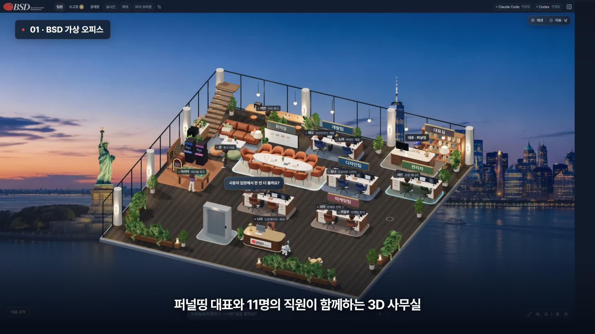

# BSD Agent Office

**내 컴퓨터에 AI 직원들이 출근하는 3D 사무실.**

Claude Code와 Codex CLI로 직원에게 질문하고 업무를 맡기는 개인용 3D 사무실입니다. 소스 코드는 **MIT 오픈소스**로 무료 공개합니다. 포크해서 직원 이름, 팀 구성, 가구, 배경과 브랜드를 원하는 대로 바꾸세요.

[](https://github.com/kyuhyi/bsd-agent-office/releases/tag/v1.0.0)

▶ **[2분 13초 사용법 영상 · 1080p / 한국어 자막 + BGM](https://github.com/kyuhyi/bsd-agent-office/releases/download/v1.0.0/BSD-Office-Tour-Public-1080p.mp4)**

📚 **[BSD 무료자료실](https://bsd-edu.bsdfunnel.com)** · [릴리스와 영상 다운로드](https://github.com/kyuhyi/bsd-agent-office/releases/tag/v1.0.0)

## 실행

Node.js 22 이상과 로그인된 Claude Code 또는 Codex CLI를 준비합니다.

```sh
git clone https://github.com/kyuhyi/bsd-agent-office.git
cd bsd-agent-office
npm ci
npm run build
npm start
```

브라우저에서 http://127.0.0.1:43140/ 을 엽니다. Windows에서는 첫 설치와 빌드 후 `사무실 열기.vbs`로 터미널 창 없이 실행할 수 있습니다.

## 처음 사용하는 순서

1. [Claude Code](https://code.claude.com/docs/en/overview) 또는 [Codex CLI](https://github.com/openai/codex)를 공식 안내에 따라 설치합니다. 둘 다 연결하면 서로 다른 제공자로 검수할 수 있습니다.
2. 터미널에서 `claude auth login` 또는 `codex login`으로 자신의 계정에 로그인하거나, 사무실의 연결 설정에서 로그인 버튼을 누릅니다. 계정 비밀번호·인증코드는 앱이나 저장소에 넣지 마세요.
3. 연결 설정에서 실제 설치·로그인 상태를 확인합니다. 로컬 프로젝트를 선택하면 허용된 텍스트 파일의 제한된 스냅샷을 작업 참고 자료로 사용합니다.
4. 직원을 클릭해 질문하거나 업무를 지시합니다. 보고함에서 결과를 읽고, 생성 파일을 미리 보거나 다운로드합니다.
5. 캐릭터 이동·회의 소집·배경·시간·확대·회전을 자유롭게 조작해보세요. 영상은 실제 로컬 화면으로 이 흐름을 안내합니다.

앱과 소스 코드 사용료는 없습니다. **Claude·Codex의 계정, 구독 및 사용량 비용은 별도**이며 무료·무제한 AI 추론을 제공하는 서비스는 아닙니다. Windows에서 검증했으며 다른 운영체제의 CLI 자동 탐색과 로그인 흐름은 별도 확인이 필요합니다.

## 내 사무실로 커스터마이징

| 바꿀 내용 | 위치 |
|---|---|
| 직원 이름·역할·제공자 | `src/features/characters/roster.mjs`, `team.ts` |
| 대표 이름·직원 표시 | `src/features/characters/`, `src/features/office/` |
| 가구 배치·좌석·이동 경로 | `src/features/office/scene-layout.mjs` |
| 부서 팻말 | `src/features/office/ZoneSigns.tsx` |
| 배경·시간별 조명 | `src/features/environment/` |
| 캐릭터·가구 모델 | `public/models/modular-v2/` |
| 로고·심볼 | `public/brand/`, `src/features/office/BrandDetails.tsx` |
| 네온·반려동물·생활 대사 | `NeonRug.tsx`, `src/features/pets/`, `ambient-speech.mjs` |

수정 중에는 `npm run dev`를 사용하고, 배포 빌드 전 아래 검증을 실행하세요. GLB 교체 시 모델의 크기·방향·리그를 맞춰야 합니다. 자산별 조건은 [ASSETS.md](ASSETS.md)를 참고하세요.

## 기능

- 3D 사무실, 퍼널띵 대표와 직원 11명, 인포메이션 상주 담당자
- 인물 선택, 질문과 업무 지시, 결과물 미리보기와 검토
- 12석 회의실, 직접 이동과 자리 복귀, 자동 휴식과 게임
- 배경 4종, 한국 시간에 따른 조명, 랜덤 네온 카페트
- 고양이·강아지 산책, 분위기용 직원 말풍선
- Pretendard 글꼴과 다크 글래스 인터페이스

## 검증

```sh
npm test
npm run typecheck
npm run build
```

`docs/`에 아키텍처, 검증 범위와 자산 제작 기록이 있습니다. 실제 CLI 응답·결과물 검증은 `docs/square-live-v6.md`, 최신 시각 기능은 `docs/office-life-v8.md`를 참고합니다.

## 로컬 데이터와 자산

로그인 정보, 실행 데이터베이스, 작업 결과, 녹화 원본, 빌드 파일은 저장소에 포함하지 않습니다. 실행 기록과 생성 결과는 로컬 `.office/`에 저장됩니다. 앱은 루프백 주소에서만 실행하며 CLI 구독 사용량은 각 계정의 정책을 따릅니다.

3D 모델과 이미지가 포함되어 초기 다운로드가 큽니다. 코드의 [MIT 라이선스](LICENSE)와 별도로 브랜드·폰트·사진·영상에는 [자산 이용 조건](ASSETS.md)이 적용됩니다. 본인 서비스로 배포할 때 BSD 로고는 자신의 브랜드로 교체해주세요.

자동 회의 이동과 일상 말풍선은 시각적 연출입니다. 실제 업무는 사용자가 질문이나 지시를 전송했을 때 실행됩니다.

## 실행 범위

현재 업무 실행은 프로젝트의 허용된 스냅샷을 읽고 별도 결과물을 생성하는 방식입니다. 원본 프로젝트를 자유롭게 수정하거나 배포까지 자동 실행하는 시스템은 아닙니다. 로컬 실행 서버를 공용 인터넷에 그대로 노출하지 마세요. 참고 설계 문서에는 과거 목표·실험이 포함되어 있으므로 현재 동작과 구별해 읽어주세요.
